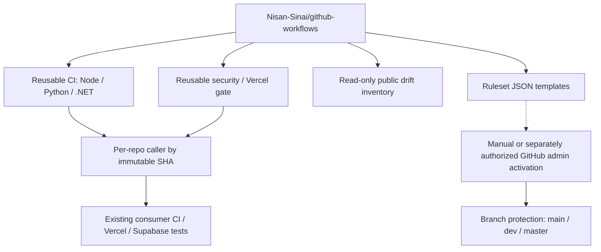

# Architecture

There is **no** implicit cross-repository write path. In consumer repos, adopt by PR and pin the hub commit. The hub CI must not publish any private-repository metadata.

Branch protection remains a repository control-plane setting, not a Git file. The chosen central hub is public to support both public and private consumers, and stores only public-safe data.
